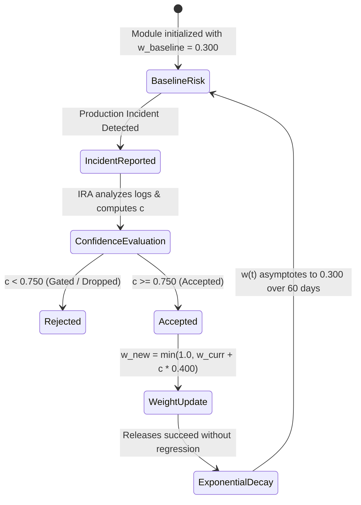

# ARIA Feedback Protocol (AFP) Specification

## 1. Protocol Purpose & Overview

The **ARIA Feedback Protocol (AFP)** is an asynchronous, event-driven feedback mechanism that closes the loop between production telemetry and pre-merge build verification.



---

## 2. Mathematical Formalization

### 2.1. Parameter Definitions
* **$w_{\text{baseline}}$**: Baseline risk weight = $0.300$
* **$c_{\text{min}}$**: Minimum diagnostic confidence threshold = $0.750$
* **$\alpha$**: Risk attribution sensitivity coefficient = $0.400$
* **$w_{\text{max}}$**: Risk saturation ceiling = $1.000$
* **$\lambda$**: Half-life decay velocity = $0.100\text{ day}^{-1}$

### 2.2. Risk Attribution Equation
When an incident is attributed to module $m$ with diagnostic confidence $c \ge c_{\text{min}}$:

$$w_{\text{new}} = \min\left(w_{\text{max}},\, w_{\text{current}} + c \times \alpha\right)$$

#### Canonical Research Example:
* Implicated Module: `checkout-cart`
* Current Risk: $w_{\text{current}} = 0.300$
* Attributed Confidence: $c = 0.870$ ($0.870 \ge 0.750$)
* Updated Risk:
  $$w_{\text{new}} = \min(1.000,\, 0.300 + 0.870 \times 0.400) = \mathbf{0.648}$$

---

### 2.3. Exponential Decay Equation
In the absence of recurring defects, accumulated risk decays exponentially toward baseline:

$$w(t) = w_{\text{baseline}} + \left(w_{\text{current}} - w_{\text{baseline}}\right) e^{-\lambda t}$$

| Horizon ($t$) | Risk Weight $w(t)$ | % Risk Decayed | Test Footprint |
|---|---|---|---|
| **Day 0** | $0.6480$ | $0.0\%$ | 1,334 tests (Expanded) |
| **Day 3** | $0.5578$ | $25.9\%$ | 1,208 tests |
| **Day 7** | $0.4728$ | $50.3\%$ | 1,089 tests |
| **Day 14** | $0.3858$ | $75.3\%$ | 968 tests |
| **Day 30** | $0.3173$ | $95.0\%$ | 871 tests |
| **Day 60** | $0.3009$ | $99.7\%$ | 847 tests (Baseline) |

---

### 2.4. Continuous Test Prioritization Equation
Candidate test cases $i$ are ranked according to a multi-objective scoring function:

$$S_i = 0.50 \cdot w_m + 0.30 \cdot f_i + 0.20 \cdot \left(1 - \frac{\text{cost}_i}{\max(\text{cost})}\right)$$

Where:
* $w_m$ = Current AFP risk weight of implicated module
* $f_i$ = Historical failure frequency ($0.0 \le f_i \le 1.0$)
* $\text{cost}_i$ = Execution duration in milliseconds

Tests are selected if $S_i \ge S_{\text{threshold}}$ ($0.450$) or if $w_m \ge 0.600$ (mandatory regression suite inclusion).

---

## 3. AFP Message Schemas

### 3.1. `AFP-INCIDENT`
```json
{
  "messageId": "afp-msg-7402",
  "type": "AFP_INCIDENT",
  "timestamp": "2026-10-22T10:14:00Z",
  "incidentId": "INC-7402",
  "implicatedModule": "checkout-cart",
  "diagnosticConfidence": 0.870,
  "evidenceTokens": ["DeserializationError", "couponMetadata", "CartPersistenceWorker"],
  "recommendedAction": "ENFORCE_STRICT_CACHE_INVALIDATION"
}
```

### 3.2. `AFP-ACK`
```json
{
  "acknowledgmentId": "ack-bia-7402",
  "respondingAgent": "BIA",
  "inResponseTo": "afp-msg-7402",
  "status": "ACCEPTED",
  "previousWeight": 0.300,
  "updatedWeight": 0.648,
  "enforcedPolicy": "strict_invalidation"
}
```
