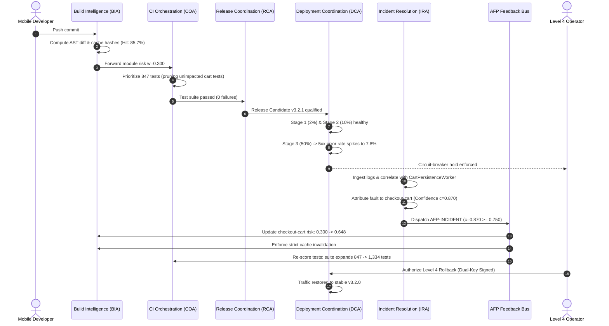

# ARIA System Architecture Specification

## 1. Architectural Overview

**ARIA (Agentic Release Intelligence Architecture)** is a closed-loop autonomous mobile DevOps control plane. It bridges the structural divide between upstream compilation/continuous testing and downstream incident resolution by propagating real-time diagnostic risk signals back to build caching and test prioritization engines.

```mermaid
graph TD
    subgraph Upstream ["Upstream Engineering Lifecycle"]
        Code[Developer Code Commit] --> BIA[Build Intelligence Agent (BIA)]
        BIA --> Cache[Build Cache Policy Engine]
        BIA --> COA[CI Orchestration Agent (COA)]
        COA --> TestSelection[Continuous Test Selection]
        TestSelection --> Matrix[Parallel Test Execution Matrix]
    end

    subgraph Governance ["Release & Deployment Gatekeeping"]
        Matrix --> RCA[Release Coordination Agent (RCA)]
        RCA --> GateCheck{Level 4 Human Gate?}
        GateCheck -- Yes --> DualKey[Dual-Key Cryptographic Sign-Off]
        GateCheck -- No --> DCA[Deployment Coordination Agent (DCA)]
        DualKey --> DCA
        DCA --> Rollout[Staged Canary Rollout 2% -> 10% -> 50% -> 100%]
    end

    subgraph Downstream ["Downstream Incident & Telemetry"]
        Rollout --> MobileUsers((Mobile User Population))
        MobileUsers --> Telemetry[Synthetic Telemetry Streamer]
        Telemetry --> DCAAnomaly{SLA Breach?}
        DCAAnomaly -- Yes --> DCACircuit[Circuit Breaker / Rollback Hold]
        Telemetry --> IRA[Incident Resolution Agent (IRA)]
        IRA --> RootCause[Semantic Stack Trace & AST Correlation]
    end

    subgraph Feedback ["ARIA Feedback Protocol (AFP) Closed Loop"]
        RootCause --> ConfGate{Confidence c >= 0.750?}
        ConfGate -- No --> Reject[AFP-REJECT / Discarded]
        ConfGate -- Yes --> AFP[AFP-INCIDENT Signal Dispatch]
        AFP --> BIAStrict[BIA: Strict Cache Invalidation]
        AFP --> COAExpand[COA: Dynamic Test Suite Expansion]
        BIAStrict -.-> Upstream
        COAExpand -.-> Upstream
    end
```

---

## 2. Five Autonomous Agents

| Agent | Acronym | Domain Responsibility | Autonomy Level | Inputs | Outputs |
|---|---|---|---|---|---|
| **Build Intelligence Agent** | `BIA` | AST diff analysis, cache fingerprinting, compilation optimization | Level 2–3 | Git commit AST, module dependency DAG, cache history | Invalidation recommendation (`standard` vs `strict_invalidation`), build risk score |
| **CI Orchestration Agent** | `COA` | Multi-objective test prioritization, cost minimization | Level 2–3 | Test metadata, historical failure rates, AFP risk weights $w_m$ | Prioritized test suite subset, execution duration estimate |
| **Release Coordination Agent** | `RCA` | Binary qualification, policy checklist verification | Level 2–3 | SAST scan results, privacy audits, crash thresholds | Release Candidate gate qualification certificate |
| **Deployment Coordination Agent** | `DCA` | Staged canary progression (2% $\to$ 10% $\to$ 50% $\to$ 100%), telemetry SLA gatekeeping | Level 3 (Pause/Hold), Level 4 (Rollback) | 5xx error rate, crash frequency, p95 latency | Anomaly alarms, cohort progression authorizations, Level 4 rollback trigger |
| **Incident Resolution Agent** | `IRA` | Log stream triage, hypothesis ranking, AST fault localization | Level 2–3 | Production exception traces, device metrics | Implicated module attribution, diagnostic confidence $c$, AFP signal dispatch |

---

## 3. End-to-End Sequence Diagram



---

## 4. Multi-Tier Governance & Autonomy Matrix

1. **Level 1 (Observe)**: Read-only passive observation of build telemetry, test outcomes, and production logging.
2. **Level 2 (Recommend)**: AI models generate hypotheses, risk rankings, and suggested remediation steps without execution authority.
3. **Level 3 (Act within Bounded Scope)**: Autonomous policy-governed state changes, including:
   - Module risk weight elevation via validated AFP-INCIDENT messages ($c \ge 0.750$).
   - Automated staged rollout pausing upon SLA boundary breach.
   - Module-scoped strict cache invalidation.
4. **Level 4 (Human-in-the-Loop Cryptographic Gate)**: High-impact actions are strictly blocked pending cryptographically verifiable dual-key human authorization:
   - Production mobile binary rollbacks.
   - Global Tier-1 build cache purges.
   - Release hold overrides.
   - Core policy reconfigurations.
